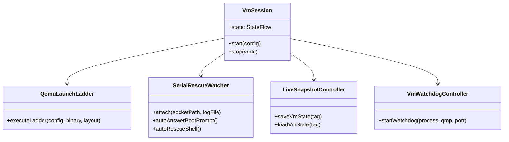

# PocketVM 全面深度优化方案

基于对当前代码库（构建、架构、Compose UI、运行时性能、测试体系）的全面审计，梳理出以下五个维度的优化建议与落地方案：

---

## 优化维度一览与优先级矩阵

| 优化项 | 类别 | 影响 / 收益 | 建议优先级 |
|---|---|---|---|
| **1. 突破 Windows 命令行超长，恢复本地 Gradle 单测** | 工程化 / 体验 | 解除 AGENTS.md 记录的 Windows 本机无法跑单测的阻塞痛点 | 🔴 P0 (最高) |
| **2. 依赖瘦身：移除 `material-icons-extended`** | 构建 / 包体积 | 削减 10~15MB APK 体积，大幅提升 dex 编译速度 | 🟡 P1 |
| **3. UI 状态解耦与 `tickLog` 轮询空转优化** | 性能 / CPU & 功耗 | 消除后台及非控制台界面的每秒无谓 I/O 与 Compose 根重组 | 🟡 P1 |
| **4. `VmSession.kt` 架构拆分与职责解耦** | 架构 / 可维护性 | 将 2154 行的单文件上帝类拆分为单一职责协同组件 | 🟡 P1 |
| **5. Gradle 配置加速与 Configuration Cache 评估** | 构建性能 | 提升本地增量构建与索引响应速度 | 🟢 P2 |
| **6. 补充并发与边界单元测试** | 质量保障 | 覆盖 `VmSessionHost` 与多机同跑的竞态条件 | 🟢 P2 |

---

## 详细优化措施与技术方案

### 1. 突破 Windows 本机 Gradle 单测命令行超长限制 (P0)

#### 痛点根因
- 在 Windows 环境下，命令提示符与进程调用的命令行长度硬限制为 **32,767 字符**。
- `debugUnitTestRuntimeClasspath` 当前包含约 490 个 jar，总路径字符达 81K+，导致 Java 启动参数在 Windows 上被物理截断，抛出 `ClassNotFoundException: <截断的路径片段>`。

#### 优化方案
在 `android/app/build.gradle.kts` 中，利用 Java 9+ 原生支持的 **Argument File (`@argfile`)** 或配置 Gradle Test 任务的 classpath 缩短策略：

```kotlin
// android/app/build.gradle.kts
tasks.withType<Test>().configureEach {
    // 强制使用 argument file 传递 classpath，避免 Windows 命令行 32767 截断
    extensions.configure<org.gradle.api.plugins.JavaPluginExtension> {
        // 或针对特定 Gradle/AGP 版本设置：
    }
    // 方式 A：通过 JVM 参数或启用 Pathing Jar
    // 方式 B：配置 command line argument providers 使用文件打包 classpath
}
```
*注：可通过配置 Test 任务的 classpath 打包机制，使 Windows 开发者可以直接运行 `./gradlew :app:testDebugUnitTest`，无需退回 CI 校验。*

---

### 2. 移除 `material-icons-extended` 依赖 (P1)

#### 现状与分析
- `libs.androidx.compose.material.icons.extended` 包含数以万计的图标类。
- 代码库全局检索发现，实际上仅使用了 18 个左右的图标（如 `Terminal`, `Speed`, `Memory`, `Dashboard`, `PlayArrow`, `Stop`, `Storage` 等）。
- 引入该包导致未开启混淆（Debug/Perf 构建）时 DEX 臃肿，编译时间明显延长。

#### 优化步骤
1. 将用到的 18 个图标以原生 Compose `ImageVector` 独立抽取或引入（或只保留核心 `material-icons-core`）。
2. 从 `android/app/build.gradle.kts` 和 `libs.versions.toml` 中彻底移除 `androidx-compose-material-icons-extended`。

---

### 3. UI 状态解耦与 `tickLog` 轮询优化 (P1)

#### 痛点根因
1. **全量 State 更新频繁**：
   - `VmViewModel.UiState` 包含了 30+ 字段。
   - 1Hz 的性能采样（`metrics`）和每秒一次的 `tickLog` 会不断创建新的 `UiState` 实例。
   - `PocketVmRoot` 根 Composable 订阅了整个 `ui` 流，导致根视图和未在浏览的页面高频重新计算与重组。
2. **`tickLog()` 轮询无感知**：
   - 只要有 VM 在运行，`tickLog()` 每秒都在调用 `sessions.readLog()` 与 `sessions.readSerialTail()`，解码大量文本字符串。即使用户在“虚拟机列表”或“关于”页面，也在空耗主线程算力与 GC。

#### 优化方案
- **生命周期/可见性感知**：
  - 仅在控制台页面（ConsoleScreen）处于活跃/前台时才触发日志和串口尾部的定时刷新。
  - 用户切离控制台时暂停定时器。
- **状态流细分（Fine-grained StateFlows）**：
  - 将高频动态的 `metrics: StateFlow<VmMetrics?>` 与 `consoleLog: StateFlow<LogState>` 独立出来。
  - 静态/配置类信息（`vms: StateFlow<List<VmConfig>>`）单独更新。
  - `PocketVmRoot` 不直接监听 1Hz 的日志变化，从而阻断无关重组。

---

### 4. `VmSession.kt` 架构拆分 (P1)

#### 现状
`VmSession.kt` 目前已达 2154 行，职责重叠过多：
- QEMU 进程守护与优雅关机（QMP `system_powerdown` -> `quit` -> `kill`）
- 降级阶梯执行循环（标准 -> 兼容 -> 最小）
- 串口监听与 UEFI Shell 自动恢复指令注入
- 运行期看门狗探测（Socket 探测 + QMP 往返）
- 性能指标采集协同
- 快照控制（`savevm` / `loadvm`）
- Apple T8030 专用启动链

#### 重构解耦路径

- **收益**：核心文件从 2100+ 行降至 500~600 行，各个子功能可独立进行纯 JVM 单元测试模拟。

---

### 5. Gradle 构建性能与 JVM 堆分配 (P2)

#### 优化配置建议
1. **提高 Gradle Daemon 堆上限**（`android/gradle.properties`）：
   ```properties
   # 当前配置 1536m 对于 KSP2 + Hilt + Compose 编译器偏紧
   org.gradle.jvmargs=-Xmx2560m -XX:MaxMetaspaceSize=512m -Dfile.encoding=UTF-8
   ```
2. **评估启用 Configuration Cache**：
   - AGP 9.1 + Gradle 9.3 官方完全支持 Configuration Cache。
   - 验证 `verifyQemuPacPatch` 任务与 KSP 输出是否符合缓存规范，启用后二次构建可跳过配置期（秒级响应）。

---

### 6. 并发与未覆盖边界单测补全 (P2)

针对多机同跑第一版与新功能，补齐以下重点单测：
- **`VmSessionHostTest`**：测试并发启动多台 VM 时的内存预算超额拦截、端口避让分配逻辑。
- **`DiskProvisionerTest`**：补充未打包 `qemu-img` 时的 QCOW2 自研检查与修复回退路径测试。
- **`LogCleanupWorkerTest`**：测试 90 天前日志组与孤儿临时文件的清理边界。
