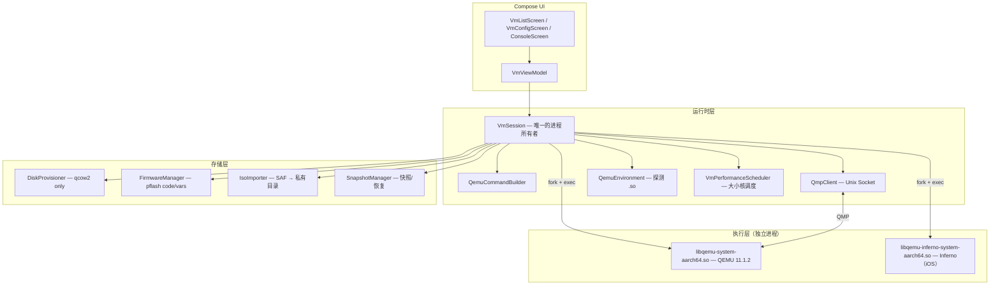
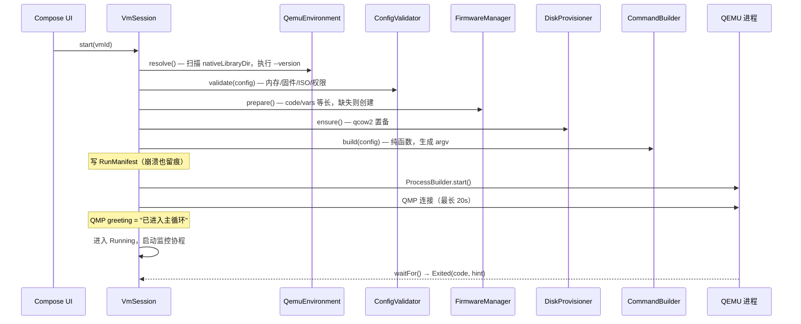

# PocketVM 项目全景

## 一句话定位

**在未 Root 的 ARM64 Android 手机上，用 QEMU TCG 软模拟运行 Windows / Linux / iOS 虚拟机。**

> [!IMPORTANT]
> 目标设备：小米 14 Pro（骁龙 8 Gen 3），未 Root。已在真机上完成 Windows 11 ARM64 从安装到桌面的全流程。

---

## 架构总览



### 核心设计原则

| # | 原则 | 说明 |
|---|------|------|
| 1 | **管理层与执行层分离** | QEMU 是独立进程，崩溃不带走 UI |
| 2 | **先 TCG 后 KVM** | 不把硬件加速当阻塞条件 |
| 3 | **每次启动可追溯** | manifest 在 fork 前写盘，崩溃也能回溯 argv |
| 4 | **磁盘只用 qcow2** | raw 落在 FUSE 上会吃满虚拟容量 |
| 5 | **QMP 优雅关机** | ACPI → quit → kill，保护 qcow2 一致性 |

---

## 支持的平台

| 平台 | 执行层 | 状态 |
|------|--------|------|
| **Windows / Linux ARM64** | `libqemu-system-aarch64.so`（QEMU 11.1.2 + edk2） | ✅ Win11 已到桌面 |
| **iPhone 11（iOS）** | `libqemu-inferno-system-aarch64.so`（Inferno，QEMU 10.0.2 fork） | ⚠️ 卡在 data-protection panic，需重新 restore |
| **Android ARM64** | 复用 UEFI 链路，导入预制磁盘镜像 | ⚠️ 实验阶段 |

---

## 技术栈

| 层 | 技术 |
|----|------|
| 语言 | Kotlin 2.2.10 |
| UI | Jetpack Compose（BOM 2024.10.01） |
| 构建 | AGP 9.1.1 / Gradle 9.3.1 / compileSdk 37（Android 17） |
| DI | Hilt 2.59.1 |
| 数据 | Room 2.7.2 + DataStore Preferences |
| 导航 | Navigation Compose |
| 定时任务 | WorkManager 2.12.0（日志清理） |
| 执行层 | QEMU 11.1.2 TCG / Inferno（iOS） |
| 固件 | edk2 2026.08（AAVMF，64 MiB pflash） |

---

## 源码结构

```
android/app/src/main/java/dev/pocketvm/
├── core/model/        VmConfig, VmPlatform, RunManifest, VmRuntimeState
├── core/config/       ConfigValidator, VmConfigStore
├── data/              Room (VmDatabase, VmConfigDao), DataStore, Repository
├── di/                Hilt AppModule
├── runtime/           QEMU 探测/参数构建/QMP/进程监督/性能调度/热管理
├── storage/           磁盘置备/固件/ISO/快照/VM 复制/Apple 资产
├── diagnostics/       日志/manifest/诊断包/看门狗/性能仪表/启动报表
├── tpm/               软件 TPM 进程管理
├── gsi/               GSI 组件拼装（实验）
├── debug/             本机只读调试接口
├── navigation/        Navigation Compose 路由
├── ui/                Compose 界面（列表/编辑/控制台/诊断/环境/关于）
├── work/              WorkManager 日志清理
└── PocketVmApp.kt     Hilt 入口 + WorkManager 配置
```

---

## 一次启动的流程



---

## 关键工程挑战（已解决）

| 挑战 | 解法 | 版本 |
|------|------|------|
| Android W^X：filesDir 不可执行 | QEMU 改名 `lib*.so`，放 jniLibs，`useLegacyPackaging=true` | 0.6.x |
| 静态链接 bionic 自举 SIGSEGV | 动态 PIE，由 `/system/bin/linker64` 加载 | 0.6.x |
| ARMv9 PAC 跨线程协程 SIGILL | PAC-free 协程切换补丁（patch-qemu-pac.py） | 0.10.10 |
| 16 KB 页设备 linker64 拒绝加载 | PT_LOAD 对齐 0x4000 | 0.10.17 |
| MIUI cgroup 冻结导致"停摆" | H4 采样间隙检测 + 电池白名单引导 | 0.10.29 |
| PID 获取反射在 ART 上失效 | `/proc` 扫描兜底（ppid + cmdline） | 0.10.8 |

---

## 测试

- **307 个纯 JVM 单测**（45 个测试文件），无 Robolectric / `androidTest`
- CI：GitHub Actions（JDK 17 + Android SDK 37）
- 本机自检：`scripts/verify.sh`（架构/测试/APK 结构）
- ⚠️ Windows 本机无法跑 JVM 单测（classpath 超 32K 字符限制）

---

## 构建

```bash
cd android
./gradlew :app:assembleDebug                          # 调试
./gradlew :app:assemblePerf -PpvmSideBySide=true      # 侧载日常用
./gradlew :app:testDebugUnitTest                       # 单测
```

---

## 版本与里程碑

| 阶段 | 版本 | 状态 |
|------|------|------|
| **P0** | 0.1–0.10.36 | ✅ 完成 — 执行环境与启动链 |
| **P1** | 0.11.0 | ✅ 已发布 — Win11 安装到桌面 + Android 17 + 官方技术栈迁移 |
| **P2** | 0.12+（待定） | 🔜 Android GSI 启动（真机复验） |
| **P3** | 待定 | 📋 多 VM 互联与网络实验室 |
| **P4** | 待定 | 📋 KVM 硬件加速接入 |
| **P5** | 1.0 | 📋 完整移动虚拟机管理器 |

> [!NOTE]
> 当前 `main` 分支在 0.11.0 之上还有未发版改动：TPM 2.0 阶段 2、调试接口、多机同跑、VM 复制、运行时快照、qcow2 ⇄ raw 转换等，均待真机验证。
